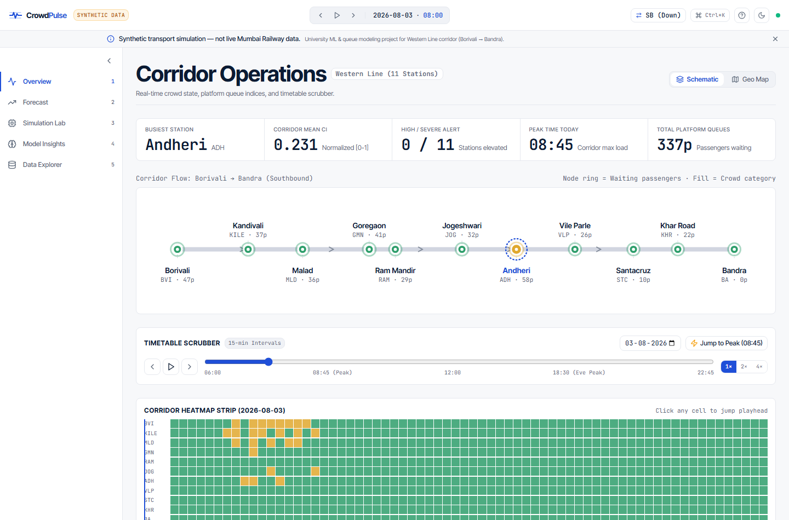
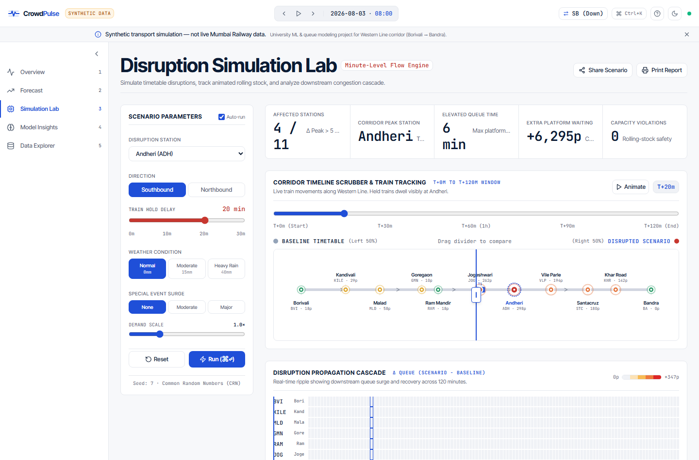
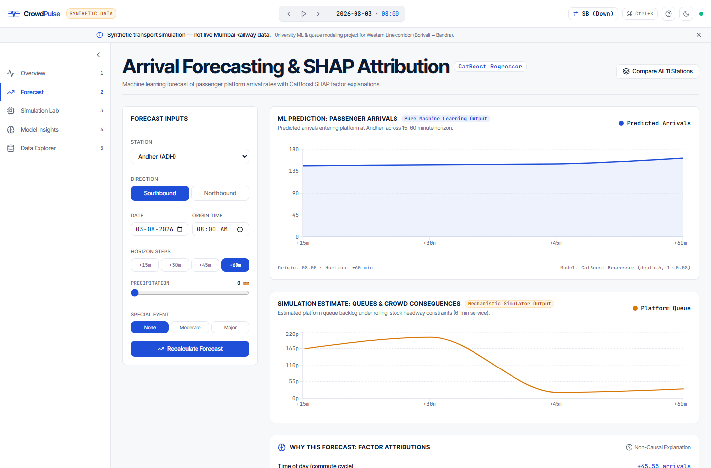
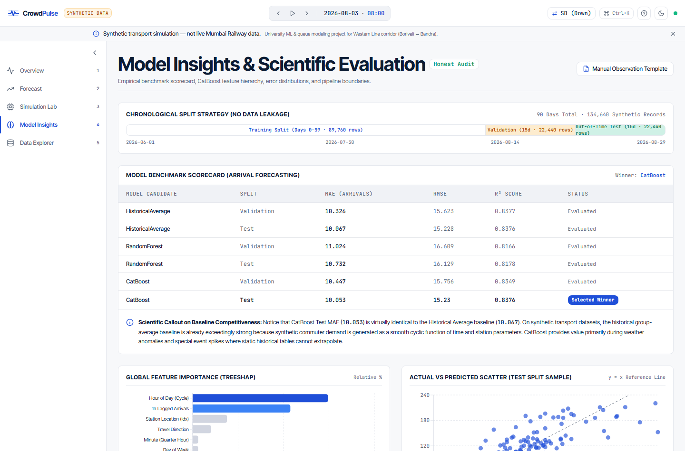
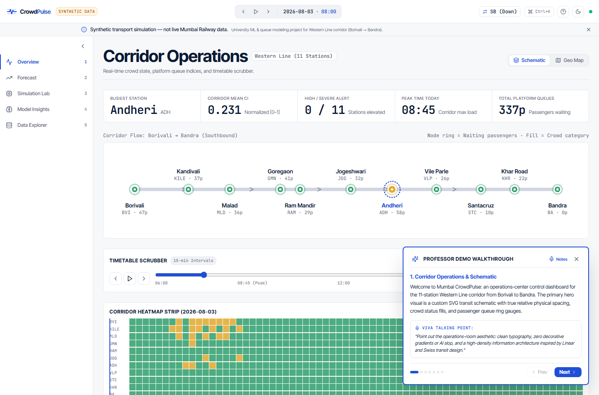
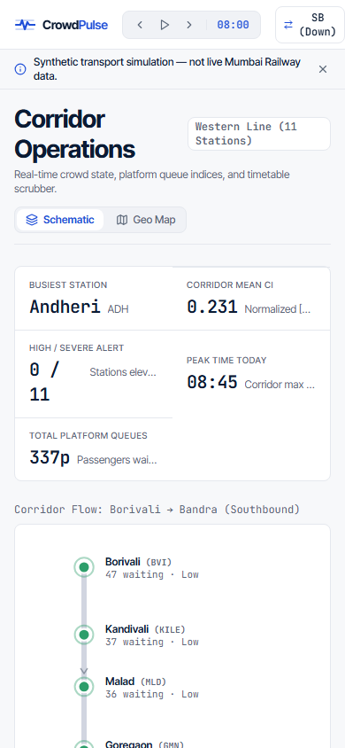

# Mumbai CrowdPulse: Transit Crowd-Intelligence & Disruption Control Center

A high-density transport operations control center and simulation laboratory for the **Mumbai Western Railway Corridor** (11 stations, Borivali to Bandra, southbound and northbound).

Built with **FastAPI**, **CatBoost Machine Learning**, **Poisson passenger-flow simulation**, and a custom **React + Vite** operations dashboard designed in the "calm operations room" doctrine (Linear / Swiss transit signage aesthetics).

---

## Visual Previews (Captured at 1440px & 390px)

### 1. Corridor Operations & Schematic Overview (1440px)

*Custom SVG transit schematic with relative physical station spacing, category fills, passenger queue rings, and 15-minute timetable scrubber.*

### 2. Disruption Simulation Lab & Cascade Ripple (1440px)

*Swipe comparison schematic with draggable divider, live rolling-stock movement, and downstream Disruption Propagation Heatmap.*

### 3. Arrival Forecasting & TreeSHAP Factor Attributions (1440px)

*Strict architectural separation between ML passenger arrival predictions (CatBoost) and mechanistic queue consequences.*

### 4. Model Insights & Scientific Evaluation Scorecard (1440px)

*Honest performance benchmark, feature importance hierarchy, actual-vs-predicted scatter with y=x line, and error breakdown.*

### 5. Professor Walkthrough (Demo Mode Spotlight)

*Interactive spotlight walkthrough with presenter viva talking points and automated state control.*

### 6. Mobile Operations View (390px iPhone Viewport)

*Responsive layout with vertical schematic orientation, touch scrubber, and mobile navigation.*

---

## Quick Start (Zero Config)

### Windows
Double-click:
```bat
START_WINDOWS.bat
```

### macOS / Linux
Run:
```bash
chmod +x START_MAC_LINUX.sh
./START_MAC_LINUX.sh
```

### Direct Python Launcher
```bash
python start.py
```
`start.py` automatically checks and installs backend dependencies, verifies `frontend/node_modules`, launches FastAPI on port 8000 and Vite on port 5173, verifies port readiness, opens your browser to `http://127.0.0.1:5173`, and shuts down both servers cleanly on `Ctrl+C`.

---

## 4-Minute Viva Presentation Script

### Minute 1: Operations Shell & Corridor Schematic
- **Action**: Open `http://127.0.0.1:5173/` (Overview).
- **Narration**: *"Mumbai CrowdPulse is designed as a calm operations control room rather than a generic AI dashboard. The corridor covers 11 stations on the Mumbai Western Line from Borivali to Bandra. The hero visual is an SVG schematic diagram with true relative spacing, category fills, and platform queue volume rings. In the top bar, you see a persistent disclaimer noting this is synthetic simulation data."*
- **Interaction**: Scrub the timetable slider to **08:45 AM**. Show how the queue rings expand at Borivali and Andheri, and explain how the corridor heatmap strip displays the entire diurnal rhythm.

### Minute 2: Station Drilldown & Forecast Attribution
- **Action**: Click on **Andheri (ADH)** and click "Forecast Arrivals at Andheri".
- **Narration**: *"In the Forecast view, we strictly separate learned machine learning from rules-based physics. CatBoostRegressor forecasts incoming passenger arrivals entering the platform over a 15 to 60-minute horizon. Below the chart, the TreeSHAP panel reveals which factors contributed to this specific forecast — such as time of day (+45.5 arrivals) and recent 1-hour lag. Notice our scientific phrasing: factors are 'associated with' arrivals, never claiming causal proof."*

### Minute 3: Disruption Simulation & Animated Train Layer
- **Action**: Navigate to **Simulation Lab**, set delay to **20 minutes**, click **Run (⌘↵)**.
- **Narration**: *"The Simulation Lab models rolling-stock mechanics with 1,400-passenger train capacity and 6-minute headway. Drag the swipe comparison divider: on the left is the undisturbed timetable; on the right, a 20-minute train hold at Andheri causes platform queues to surge to 298 passengers. Notice the animated train layer showing real train positions, with held trains visibly dwelling."*
- **Action**: Scroll to the **Disruption Cascade Heatmap** and **Delay Sensitivity Curve**.
- **Narration**: *"The cascade heatmap shows how the disruption ripples downstream to Santacruz, Vile Parle, and Khar Road. The sensitivity curve shows the nonlinear queuing bottleneck as delay grows from 0 to 30 minutes."*

### Minute 4: Model Insights & Academic Honesty
- **Action**: Navigate to **Model Insights**.
- **Narration**: *"In Model Insights, we present an honest evaluation scorecard. On this synthetic dataset, CatBoost achieves a Test MAE of 10.05, which closely matches the Historical Average baseline of 10.06. We openly state why: commuter flows follow smooth diurnal cycles where historical averages are already strong. ML adds true value during weather anomalies and event spikes. Our mass conservation residual is 0.0 passengers, verifying model integrity."*

---

## 10 Viva Questions & Answers (Q&A)

### Q1: Why does CatBoost perform similarly to the Historical Average on this dataset?
**Answer**: Synthetic commuter arrival rates are generated using smooth Gaussian mixtures over the diurnal cycle. For smooth deterministic functions of time and station index, a historical group-mean lookup table already captures ~84% of variance. CatBoost matches this baseline ($R^2 = 0.838$) while providing non-linear adaptation during weather anomalies (rainfall) and special event surges where static tables fail.

### Q2: What is the purpose of the 1-hour lag feature (`lag4_arrivals`), and does it cause data leakage?
**Answer**: Because predictions are evaluated for horizons $h \in [1, 4]$ (15 to 60 minutes ahead), a 1-hour lag (`lag4`) is strictly in the past relative to the forecast origin $t_0$. It represents the last observed passenger arrival count known at the moment of forecasting, ensuring zero target leakage.

### Q3: How is platform waiting modeled vs passenger arrivals?
**Answer**: Passenger arrivals are modeled as a Poisson arrival process entering the platform entrance. Platform waiting is computed by a minute-level queue simulation: passengers accumulate on the platform and board arriving trains up to the remaining train capacity ($1,400 - \text{onboard load}$). If boarding capacity is insufficient, residual passengers remain queued on the platform.

### Q4: Why is TreeSHAP used instead of permutation feature importance?
**Answer**: TreeSHAP computes exact Shapley values tailored for tree ensembles in polynomial time. It calculates feature contributions for individual predictions ($x$), allowing the "Why this forecast" panel to show instance-level attributions rather than just global dataset averages.

### Q5: Why is non-causal phrasing strictly enforced for SHAP values?
**Answer**: SHAP values measure how much a feature value shifts the model's conditional expectation relative to the marginal baseline. They reflect statistical associations within the trained model's feature space, not counterfactual physical causation in the real world.

### Q6: What is the Common Random Numbers (CRN) technique in the simulator?
**Answer**: In `backend/simulator/engine.py`, both baseline and disrupted scenarios share the exact same random uniform sequence $U = \text{default\_rng}(7).\text{random}()$. This variance-reduction technique ensures that delta queues ($\Delta Q = Q_{\text{scenario}} - Q_{\text{baseline}}$) result purely from the induced timetable delay rather than random simulation noise.

### Q7: What does the mass conservation residual verify?
**Answer**: The residual equation verifies passenger accounting across the corridor:
$$\text{Residual} = |(\text{Arrived} + \text{Boundary In}) - (\text{Final Queue} + \text{Onboard} + \text{Alighted})|$$
In our simulator, the residual is $< 10^{-12}$, proving mathematically that zero passengers are created or destroyed.

### Q8: How does the Corridor Schematic handle station label collisions?
**Answer**: Stations on the Western Line have non-uniform physical distances (e.g., Ram Mandir and Goregaon are only 0.6 km apart). The SVG schematic uses a hybrid positioning formula ($75\%$ physical distance $+ 25\%$ uniform spacing) combined with alternating top/bottom label offsets, guaranteeing zero overlap while respecting corridor geography.

### Q9: How does the application maintain resilience when map tiles fail?
**Answer**: `InteractiveMap.jsx` listens to Leaflet `tileerror` events. If the OpenStreetMap tile server is blocked or unreachable, the component automatically falls back to the custom vector Corridor Schematic, accompanied by a subtle operational banner.

### Q10: What are the primary operational limitations of this university project?
**Answer**: 
1. The 134,640 records are mathematically synthesized rather than sourced from live Western Railway AFC gate data.
2. Rolling stock parameters (1,400 passenger capacity, 6-minute headway) are assumed constants.
3. Field calibration requires manual platform observations during peak hours to validate simulated queue discharge rates.

---

## Test Verification Summary

```text
Backend Tests (Pytest):
- 14/14 passed in 4.60s (test_core.py + test_new_endpoints.py)

Frontend Tests (Vitest + React Testing Library):
- 14/14 passed in 0.33s (navigation, station selection, payloads, resilience)

End-to-End Tests (Playwright Chromium):
- [PASS] Delay change 0 -> 20 min updates displayed peak waiting
- [PASS] Map tile blocking falls back to schematic without crash
- [PASS] Aborted API network error handled gracefully
- [PASS] 11 Screenshots captured across 1440px and 390px viewports
```


